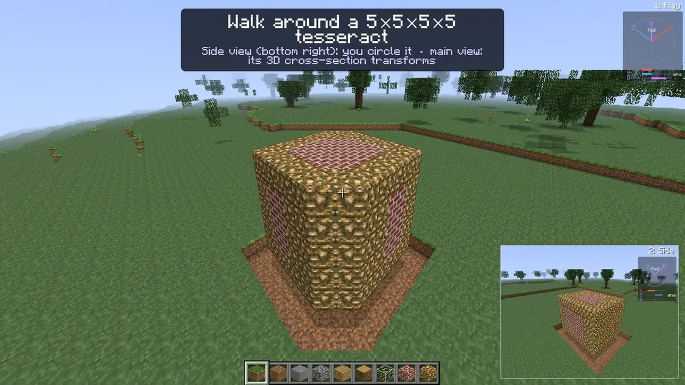

# mc_4d

A Minecraft-like voxel sandbox in four spatial dimensions (X, Y, Z, W), written in Rust with `wgpu` and `winit`.

You see a 3D slice of the 4D world through your body. You can move along the 4th direction or rotate the slice into it, and the blocks (tesseracts) change shape as the slice cuts them differently. See [DESIGN.md](DESIGN.md) for how it works.

[](docs/intro.mp4)

**[▶ Watch the full 67-second intro video (1080p MP4)](docs/intro.mp4)**. It opens with a walk around a 5×5×5×5 tesseract through W (the side view circles it while the main view's cross-section transforms), then walks a beach of grass, sand and water, steps and turns into W, snaps back, passes through a hollow tesseract along the 4th dimension, tilts the slice, and shows the tesseract lit by torches at night, ghost layers and creatures. The keys being pressed are shown on screen, and every view shows its own 4D compass.

## Running

```sh
cargo run --release
```

The title screen opens first. Choose **Singleplayer**, select a saved world and choose **Play Selected World**, or use **Create New World**. Rename changes the display name without moving its chunks; Delete asks for confirmation. On first play, an interactive tutorial explains four-dimensional space, movement, rotation and simultaneous slices. Replay it from Esc → Tutorial. Select **Options → Language / 语言** for English or Simplified Chinese.

World selection, seed, game mode, language and slice layouts are configured through the main screen and Options. Their old startup flags have been removed. Development options (`--help` lists all of them):

| Option | Meaning |
|---|---|
| `--data-dir DIR` | Keep settings, controls and saves under `DIR` |

Settings, controls and saves live in the platform config and data directories (on Linux, `~/.config/mc4d/` and `~/.local/share/mc4d/`).

On Windows, build with `cargo build --release --locked` and run `target\release\mc4d.exe`. To keep settings and saves beside the checkout, use `target\release\mc4d.exe --data-dir data`. The same game code and embedded assets are used on both platforms; native Windows verification is delegated to a Windows tester.

For the experimental Linux-hosted Windows cross-build helper, `python3 scripts/prepare_windows_toolchain.py` prepares matching official components under `target/tooling/windows`, and `python3 scripts/build_windows.py --offline` uses an isolated target directory. This does not modify the installed Rust toolchain. The build script records its result and, on success, creates a portable ZIP under `target/dist`. The minimal official component set currently reaches the link step but lacks `OpenGL32` import libraries; completing that helper requires a full graphics-capable Windows linker SDK. Native Windows builds use their own toolchain/SDK.


## Default controls

Every binding can be changed under **Esc → Controls**. Click a binding and press a key, mouse button or wheel direction. Right-click a binding to clear it. Conflicting bindings are shown in red. Your bindings are saved to `controls.toml`.

| Input | Action |
|---|---|
| Mouse | Look (yaw / pitch) |
| W A S D | Move within the slice |
| Z / C | Move kata / ana (along the 4th direction) |
| E | Open / close inventory |
| Q | Drop one selected item |
| Space / Left Shift | Jump / sneak (fly up / down in Creative); double-tap Space to toggle Creative flight |
| T or / | Open local chat and commands (`/help`, `/time`, `/weather`, `/gamemode`, `/give`, `/tp`) |
| Left Ctrl | Sprint |
| Mouse wheel | Select hotbar slot |
| Hold Left Alt + wheel, or `[` / `]` | Turn forward into ana / kata |
| `;` / `'` | Swing right into kata / ana |
| Hold Left Alt + mouse | Rotate the slice freely |
| R | Snap the slice back onto the axes (keeps your facing direction) |
| Tab | Flip 90° into W |
| X | Switch the main view to the displayed side view; keeps position/pitch/forward, four presses restore the original frame |
| G | Ghost layers: red = just ana of your slice, blue = just kata |
| V | Toggle additional slice views (choose 2, 4, 6 or 9 under Options) |
| B | 4D glasses: outlines of creatures in nearby slices |
| Left / right mouse button | Break / place block |
| Middle mouse button | Pick block |
| 1–9 | Hotbar slot |
| F | Cycle render distance, as in Beta |
| F1 / F2 / F3 | Hide HUD / screenshot / toggle debug overlay (on by default) |
| F5 | Toggle the rear third-person camera (four-block boom with wall clearance) |
| F11 | Toggle borderless fullscreen (also in Options → Video) |
| Enter | Continue the tutorial |
| Esc | Pause menu: options, controls, tutorial, game mode, save |

Boats can be placed by right-clicking water. Right-click a boat or an empty minecart to ride; use movement keys to steer a boat or nudge a stopped cart, and Sneak or right-click again to exit. Z/C also steers through the fourth direction. Chest minecarts open a 27-slot container; right-click a furnace minecart with coal to fuel it and push it away from you. Rails support slopes, curves, powered sections and detector outputs, including W-axis tracks.

## HUD

- **Top left:** your XYZW position, the slice normal ("ana"), and how far the slice is tilted from the world axes.
- **Top right:** the 4D compass. Arrows show where world X, Z and W point on screen. Bars show how much of each axis points along ana, out of your slice.
- **Bottom right:** the side view, with ana pointing to the right and its own compass showing the axes projected into that view. X promotes this orientation to the main view; aiming and movement follow it.
- **4/6/9-view grids** (Options → 4D Settings → Slice layout): every view has its own compass in its top-right corner. Compasses follow the HUD/debug visibility settings.

## Development

```sh
cargo test --workspace          # core math, physics, terrain, input, tutorial, WGSL validation
cargo run -- --screenshot out.png --ana 30 --ghosts   # headless render to PNG
cargo run --release -- --bench 200                    # headless frame-time benchmark
cargo run --release -- --data-dir target/perf --benchmark-gameplay target/perf.toml --performance-test 90   # windowed gameplay route (needs an unlocked desktop)
cargo run --release -- --data-dir target/perf --benchmark-gameplay target/perf.toml --headless-route    # same route offscreen (no compositor)
cargo run -- --smoke-test 5 --data-dir target/smoke-data      # open the window briefly, screenshot, exit
cargo run --release -- --video master.mkv --size 1920x1080 --lossless   # render the intro video (needs ffmpeg)
cargo run --release -- --video-stills target/intro-stills      # one preview still per shot of the video
```

A separate detailed tutorial storyboard is available with `--tutorial-video-stills target/tutorial-stills`, or `--tutorial-video target/tutorial.mp4` for encoding. Use `--video-language zh` for Chinese captions. It covers supercube concepts before controls, Creative and Survival, and optional4/6/9-view layouts; the intro stays with the default main and auxiliary views.

Video rendering defaults to **1920×1080**; `--size` overrides it.

The intro video is scripted in `crates/app/src/video.rs`: a list of shots with camera paths, captions and the keys shown on screen. It renders headlessly and pipes frames to ffmpeg (`--ffmpeg PATH` if it isn't on `PATH`). The committed files are encoded from that lossless master:

```sh
# 1080p H.264, two-pass at ~5.8 Mbps (stays under GitHub's 50 MB warning)
ffmpeg -i master.mkv -c:v libx264 -preset slow -b:v 5800k -pass 1 -pix_fmt yuv420p -an -f null /dev/null
ffmpeg -i master.mkv -c:v libx264 -preset slow -b:v 5800k -pass 2 -pix_fmt yuv420p -movflags +faststart docs/intro.mp4
# inline README teaser: the tesseract walk-around, 1120 px, 16 fps
ffmpeg -ss 0.5 -t 9.3 -i master.mkv -vf "fps=16,scale=1120:-1:flags=lanczos" -c:v libwebp_anim -quality 75 -compression_level 6 -loop 0 docs/intro-teaser.webp
```

Headless options: `--size WxH`, `--pos X,Y,Z,W`, `--yaw/--pitch/--ana/--right-ana DEG`, `--no-hud`, `--no-inset`, `--debug`, `--tutorial N`.

Crates:

- `crates/core` (`mc4d-core`): orientation math, chunks, terrain, 4D DDA ray-cast, physics and saving. It has no GPU code.
- `crates/render` (`mc4d-render`): the `wgpu` ray-caster (`shaders/raycast.wgsl`) and GPU chunk residency.
- `crates/app` (`mc4d`): the binary, with the winit loop, rebindable input, game logic, egui HUD and menus, and the tutorial.

The bundled DejaVu and Noto CJK fonts (`crates/app/assets/fonts`) are under their own licenses; see `LICENSE-DejaVu` and `LICENSE-Noto`. The Noto font is a static regular-weight subset generated from Noto Sans CJK SC for Chinese UI support.

## Expansion status

Beta 1.5 coverage is tracked in [beta-feature-audit.json](docs/beta-feature-audit.json) and [implementation-status.json](docs/implementation-status.json).

Performance target: at least 20 FPS at native resolution (render scale is never lowered automatically) for windows up to 1920×1200 on a Radeon 680M iGPU with the GPU cooled down. How it is reached:

- **Exact acceleration in the 4D ray caster:** a per-tile beam prepass gives rays a safe start distance, a 2×2×2×2 empty-space level complements the 4×4×4×4 macrocells, and tiles without entities use a shader variant without the entity models (half the GPU registers). Images are identical to the plain traversal.
- **Background workers yield during play.** Chunk generation and lighting run at a 50% duty cycle while a world is visible (a saturated core took package power from the GPU); loading screens run them at full speed.
- **Unpaced presentation** keeps the GPU clocked up; Options → Video → Limit Framerate restores 60 Hz pacing.

F3 shows the ray-casting GPU time. `--benchmark-gameplay` (windowed) and `--headless-route` (offscreen) record per-frame timings for a scripted route.

Inventory has a nine-slot hotbar plus 27 storage slots. Left-click moves a stack, right-click splits or places one item, and Shift-click transfers between storage and hotbar. In Creative, use the searchable catalog to choose a block. Dropped items can be picked up again. Old saves remain readable.

The primary view is the only interaction view. All additional views share your position and show different planes through X/Z/W. Their chunks are streamed together so views can reveal terrain outside the primary slice.

The reference JAR, inspection data and comparison captures stay in the ignored `target/reference/beta-1.5` directory. Selected classic textures and short sound effects are bundled with source notices in their asset directories; they retain their original rights and are not covered by the Rust code license. Full music recordings are not bundled. The official Beta 1.5 JAR and the complete legacy external-asset index were hash-verified; the legacy index also includes assets from later versions.

## Windows and Linux

Build with the stable Rust toolchain: `cargo build --release --locked`. Linux builds need the ALSA development package (`libasound2-dev` on Debian/Ubuntu or `alsa-lib-devel` on Fedora) and `pkg-config`.
On Linux run `./target/release/mc4d`; in Windows PowerShell run `.\target\release\mc4d.exe`.
Fonts and shaders are bundled, so the executable does not require a separate asset directory. Video export additionally requires FFmpeg on PATH or `--ffmpeg PATH`.

The [build workflow](.github/workflows/build.yml) runs simulation/save/shader tests and release builds on Linux and Windows. It has been added locally; a successful Windows CI run and Windows GPU runtime test are still pending.

To cross-compile the Windows build on Linux: `python3 scripts/prepare_windows_toolchain.py`, then `python3 scripts/build_windows.py` (needs `llvm-dlltool`, which generates the `opengl32` import library from `scripts/windows/opengl32.def`). The result is `target/dist/mc4d-windows-x86_64.zip` with `mc4d.exe` (no console window; it still prints to a terminal it was started from) and `Play.bat`.

For an isolated local save location on either platform, pass `--data-dir ./mc4d-data`. To render a 1080p video on either platform:

```text
cargo run --release -- --video intro.mp4
```

Paintings use the original25 motives and can be placed on X, Z or W walls. The compass points toward world spawn within your current slice; the clock follows world time. Jukeboxes accept and eject records. Bundled playback uses original procedural arrangements; a selected texture-pack folder may provide `records/13.ogg` and `records/cat.ogg` (or the legacy `streaming/` paths) for locally supplied recordings.
